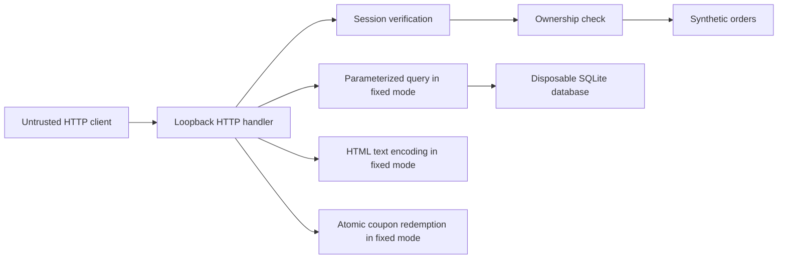

# Architecture and security requirements

## Request flow and trust boundaries

The entry point is [lab/app.py](../lab/app.py). `ThreadingHTTPServer` binds to `127.0.0.1`; each server owns one `Shop` instance. Orders are in-memory synthetic records. Product search creates a disposable SQLite database per request. Coupon state and its lock live in the server process. There is no external payment, account database, upload handler or remote integration.

The diagram summarizes relevant flows. Public `/health`, `/`, `/search` and `/reflect` handlers run before authentication. `/me` and `/orders/...` require `Shop.authenticate`; coupon POST also passes the authentication check. `/login` validates synthetic credentials and issues a cookie.

## Security requirements and implementation choices

| Requirement | Implementation | Remaining boundary |
| --- | --- | --- |
| Identity must be verified before protected access | Fixed mode verifies a session HMAC, expiry and known username | Synthetic accounts; no logout/revocation lifecycle |
| Only an order's owner may read it | `Shop.order` compares `owner_id` with verified identity | This example covers one resource type |
| Search input must not change SQL structure | SQLite placeholder binding in `fixed_sql.py` | Parameter binding does not define business permissions by itself |
| Reflected text must remain text in HTML | `html.escape(term)` plus CSP | Encoding is specific to the HTML text context |
| A coupon may be consumed at most once | Lock encloses check and state mutation | Lock is process-local, not distributed |
| Scanner errors must not become a passing result | Completion states and gate logic in `security_scan.py` | Tool/advisory availability can still block execution |

## Authentication and authorization are separate

`Shop.login` checks a PBKDF2-derived password value with `hmac.compare_digest`, then signs `user:expiry` with an in-memory random key. The cookie is `HttpOnly` and `SameSite=Strict`. The service uses HTTP on loopback; production transport and `Secure` cookies require a different deployment design.

In fixed mode, `Shop.authenticate` verifies the signature and expiry and returns the user. The handler returns 401 if no valid identity is available. `Shop.order` then returns 403 if that user does not own the requested record. A valid owner gets 200. The session payload is signed, not encrypted.

Vulnerable mode deliberately trusts the client-controlled `X-User` header, defaulting to Alice, and omits ownership enforcement. Its successful `/login` response does not make later header-based authentication trustworthy.

## Code-review entry points

- [Application and HTTP headers](../lab/app.py): `login`, `authenticate`, `order`, `reflection`, `redeem`, `make_handler`.
- [Vulnerable SQL](../lab/vulnerable_sql.py) and [fixed SQL](../lab/fixed_sql.py): direct construction versus bound values.
- [Scanner orchestrator](../security_scan.py): actual subprocess execution, HTTP probes, source hashes and failure states.
- [ZAP diagnostics hook](../tools/zap_diagnostics.py): observe and preserve scanner/server evidence without changing the scan policy.

Fixed headers include restrictive CSP with `form-action 'none'`, `base-uri 'none'` and `frame-ancestors 'none'`, permissions restrictions, same-origin cross-origin policies and `nosniff`. They also apply to framework error responses. These choices fit this tiny same-origin lab; they need review for a different application's resource and embedding requirements.
